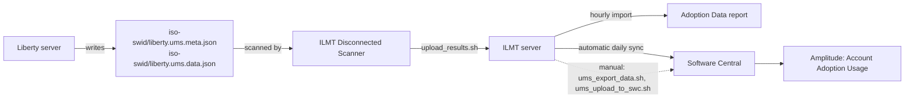

# Liberty adoption metrics for IBM License Metric Tool (ILMT)

**Status: proof of concept. This branch is for team testing and is not meant to be merged.**

This document explains how a Liberty server reports adoption data to ILMT, what code was added, what has been proven, and how to test it yourself.

Scope: the ILMT path only (Liberty, files on disk, ILMT scanner, ILMT server, Software Central). The Liberty usage metering feature (`com.ibm.ws.usage.metering`) is a separate path and is not changed.

---

## 1. How it works

Liberty does not talk to ILMT. It writes two files to disk. The ILMT Disconnected Scanner finds them, packs them, and uploads them to the ILMT server. The ILMT server imports them every hour. When the computer group has an IBM Entitlement Key, ILMT then sends the data to IBM Software Central on its own, and Software Central forwards an "Account Adoption Usage" event to Amplitude.



### The two files

| File | Purpose |
|---|---|
| `iso-swid/liberty.ums.meta.json` | Describes the metric: the mapping ID, which properties to forward (`groupBy`), the product's component ID and name, and the instance ID. |
| `iso-swid/liberty.ums.data.json` | The values. One record per write. Each record starts with the ASCII record separator (0x1E), following RFC 7464. |

Both files must be in `<install dir>/iso-swid/`. The scanner only pairs a data file with a metadata file when they sit in the same directory.

The data file is rotated at 100 KB into `liberty_N.ums.data.json`. At most 10 rotated files are kept.

### When Liberty writes

The bundle starts after the server finishes startup phase 2. It writes once immediately and then once every 24 hours. A write never throws: a failure is logged at debug level and does not stop the server.

### How ILMT matches the product

The metadata's `componentId` is the `persistentId` of the SWID tag shipped in `wlp/lib/versions/tags/`. Liberty reads the ID and the name from that tag. Nothing is hard-coded, so the same code reports the right ID for every Liberty edition.

| Product | Component ID | Product link in the ILMT test server |
|---|---|---|
| Open Liberty | `0ca5af184810448c851299b2c615ebb6` | **None for 26.0.** Product name is `<not set>`. See section 7. |
| WebSphere Application Server Liberty (base) | `fbf6a96d49214c0abc6a3bc5da6e48cd` | Yes (PVU) |
| WebSphere Application Server Liberty ILAN | `3e5b4c633588442ba04a89370ebc9832` | Yes (PVU). Used for the end-to-end proof. |

---

## 2. What is reported

Each record carries these properties. All values come from the running server or the machine. Nothing is hard-coded, except the two fields an administrator must configure.

| Field | Source |
|---|---|
| `product_name`, `product_edition`, `version` | Liberty product information files (`wlp/lib/versions/*.properties`) |
| `support_status` | `unsupported` for beta builds, otherwise `unknown` |
| `java_version`, `java_vendor`, `jvm` | JVM system properties (`jvm` maps to HotSpot, OpenJ9 or IBM J9) |
| `os_name`, `os_version` | JVM system properties |
| `infrastructure_type` | Derived: `container`, `cloud`, `vm`, `bare-metal` or `unknown` |
| `is_containerized`, `container_orchestrator` | Environment variables and files (section 3) |
| `hypervisor`, `cloud_provider` | Machine identity files and environment variables (section 3) |
| `environment_type` | **Configured** in `server.xml`: `production` or `non-production`; otherwise `unknown` |
| `customer_id` | **Configured** in `server.xml`; otherwise `unknown` |
| `application_count` | Number of application configurations (includes dropins and Spring Boot) |
| `features` | The enabled public Liberty features |
| `application_framework` | Section 4 |
| `instance_id` | SHA-256 of install directory, server name and host name |

`environment_type` and `customer_id` are configuration by design. Liberty has no way to know whether a server is production or who the customer is.

The Product ID (for example `5724J08`) is **not** sent by Liberty. ILMT adds it from its own catalog (section 5).

---

## 3. Environment detection

Detection is local and best-effort. It never makes a network call.

| Field | How it is detected |
|---|---|
| `container_orchestrator` | Environment variables: `KUBERNETES_SERVICE_HOST` (with any `OPENSHIFT_*` gives `openshift`), `ECS_CONTAINER_METADATA_URI`, `NOMAD_ALLOC_ID`, `MESOS_TASK_ID`, `CF_INSTANCE_GUID` |
| `is_containerized` | `KUBERNETES_SERVICE_HOST`, `/.dockerenv`, `/run/.containerenv`, container names in `/proc/1/cgroup`, or a container runtime bind-mounting its own `hostname`, `hosts` or `resolv.conf` over `/etc` (in `/proc/self/mountinfo`) |
| `hypervisor` | `/sys/class/dmi/id/sys_vendor`, `product_name`, `bios_vendor`, plus `/proc/cpuinfo`, `/proc/sysinfo` and `/sys/hypervisor/type`. For example a vendor containing "qemu" or a BIOS of "seabios" gives `kvm` |
| `cloud_provider` | The same machine files (AWS, GCP, Azure asset tag, Oracle, DigitalOcean, Alibaba), then environment variables for containers (`AWS_REGION`, `K_SERVICE`, `WEBSITE_SITE_NAME`, `CE_APP`) |

`none` and `unknown` mean different things: `none` is "the check ran and found nothing", `unknown` is "the check could not run".

Limits: detection reads Linux files, so Windows and macOS report `unknown` for the VM and cloud fields. Inside containers the host's machine files may be hidden. Only the listed clouds and orchestrators are recognised.

---

## 4. Application framework detection

`application_framework` reports what the **deployed applications contain**. Enabled features are not used. A server that enables `springBoot-3.0` or `microProfile-7.0` but has no matching application reports `unknown`.

Liberty's application configuration holds only a location, a type and a name. It does not say which APIs an application uses. So `ApplicationInspector` opens each deployed application (a war, ear, jar or expanded directory) and looks for these signs:

| Result | Evidence inside a deployed application |
|---|---|
| `spring-boot` | Configured as a `<springBootApplication>` (factory `com.ibm.ws.app.manager.springappcfg`, or `type=spring`), **or** manifest has `Spring-Boot-Version`, **or** a `BOOT-INF/` directory, **or** `WEB-INF/lib` holds a `spring-boot-*.jar` |
| `microprofile` | `META-INF/microprofile-config.properties` exists, **or** a class file refers to `org/eclipse/microprofile/...`, **or** `WEB-INF/lib` holds a `microprofile*` or `smallrye-*` jar |
| `jakarta-ee` | A class file refers to `jakarta/servlet/`, `jakarta/ws/rs/`, `jakarta/enterprise/`, `jakarta/persistence/` and similar (or the `javax/...` equivalents), **or** the application has `WEB-INF/web.xml`, `beans.xml`, `persistence.xml`, `faces-config.xml`, `application.xml` or `ejb-jar.xml` |
| `unknown` | No evidence found, or no application is deployed |

When several match, the most specific wins: Spring Boot, then MicroProfile, then Jakarta EE. Across several applications the evidence is combined and the same order applies.

### How the inspection is kept cheap

It runs once at start and then once a day, on the same deferrable thread as the rest of the collection. It is bounded:

- at most 20,000 entry names per application;
- at most 200 class files opened, and only the first 64 KB of each (the constant pool, which names every type the class uses, is at the start);
- jars inside `WEB-INF/lib` are judged by file name only and are never opened;
- once Spring Boot is found the scan stops; once MicroProfile is found no more classes are opened;
- nothing is written, and any failure to read an application is ignored.

Relative locations are resolved the way the application manager does: first under `${server.config.dir}/apps/`, then `${shared.app.dir}/`.

### Limits

- This is evidence, not proof. A Jakarta EE API name in a class file shows the code refers to it, not that a request used it.
- Classes are sampled (200 per application). Descriptors, the config file and library names are checked for every entry.
- An application that bundles its own copy of a framework under a different jar name is not recognised by library name. Class file references still apply.
- An application whose file cannot be found under the locations above yields no evidence, so its framework is `unknown`.

---

## 5. What was changed in the code

### New kernel bundle `dev/io.openliberty.adoption.metrics.internal`

| File | Role |
|---|---|
| `AdoptionMetricsComponent` | OSGi component. Reads server configuration, runs the collection on start and every 24 hours, finds the product and its component ID, and calls the writer. |
| `AdoptionDataCollector` | Builds the property map. Holds the list of properties sent to ILMT (`GROUP_BY`) and the framework and instance ID rules. |
| `ApplicationInspector` | Opens each deployed application and looks for Spring Boot, MicroProfile and Jakarta EE evidence (section 4). |
| `EnvironmentDetector` | Container, orchestrator, hypervisor and cloud detection. |
| `PayloadWriter` | Writes the metadata and data files in `iso-swid/`, with atomic writes and 100 KB rotation. |
| `SwidTag` | Reads `persistentId` and the name from the SWID tag in `lib/versions/tags`. Falls back to built-in IDs if no tag is found. |
| `resources/OSGI-INF/metatype/metatype.xml` | The `<adoptionMetrics>` configuration element. |
| `test/...` | Unit tests for the collector, detector, writer, tag reader and application inspector. |
| `test-apps/` | Sources and a build script for three small test applications (section 8, part B). |

### Existing file changed

`dev/com.ibm.ws.kernel.boot/publish/platform/kernelCore-1.0.mf` gets one added line, so the bundle starts at the `FEATURE_PREPARE` phase:

```
 io.openliberty.adoption.metrics.internal; version="[1.0, 1.1)"; start-phase:="FEATURE_PREPARE",
```

This file affects every Liberty build. The wider kernel tests have **not** been run for this change.

### Server configuration

```xml
<server>
  <featureManager>
    <feature>servlet-6.0</feature>
  </featureManager>
  <adoptionMetrics enabled="true"
                   customerId="my-customer"
                   environmentType="production"/>
</server>
```

| Attribute | Default | Meaning |
|---|---|---|
| `enabled` | `true` | Set `false` to turn the feature off |
| `customerId` | `unknown` | Reported as `customer_id` |
| `environmentType` | `unknown` | `production` or `non-production`; other values become `unknown` |

---

## 6. Test results so far

Only results that were observed are listed.

**Unit tests:** 49 of 49 pass on a clean run (`--rerun-tasks`).

**Detection on a real server (Open Liberty 26.0.0.9, Linux KVM virtual machine, Java 17):**

| Case | Setup | Result |
|---|---|---|
| A | Features enabled, no application | `application_count` 0, `unknown` |
| B | Jakarta EE war in `dropins/` | `application_count` 1, `jakarta-ee` |
| C | MicroProfile war in `dropins/` | `application_count` 1, `microprofile` |
| D | Spring Boot jar in `dropins/spring/` | `application_count` 1, `spring-boot` |

**End to end with WebSphere Liberty ILAN 26.0.0.9 and a Spring Boot application:**

| Step | Result |
|---|---|
| Liberty wrote both files | `componentId` `3e5b4c63...` and the name read from the shipped tag |
| Scan and upload | Succeeded, exit code 0 |
| ILMT hourly import | 1 package processed, 0 skipped, 0 invalid; `ETL from UMSImport: Success` |
| ILMT Software Classification | Component linked to product "IBM WebSphere Application Server Liberty ILAN", metric PVU |
| Amplitude | An "Account Adoption Usage" event arrived about two minutes after the import, **sent by ILMT's automatic sync** (the manual export returned "No new data available" because the data was already sent) |

The Amplitude event carried these values from our code: `application_framework` `spring-boot`, `application_count` 1, `customer_id`, `environment_type`, `hypervisor` `kvm`, `infrastructure_type` `vm`, `is_containerized` 0, Java and OS fields, `features`, `product_name`, `product_edition`, `version` and `instance_id`. ILMT added the product title, the metric `INTERNAL_PVU` and the Product ID.

**Not yet tested:**

- MicroProfile and Jakarta EE through the full ILMT and Amplitude path (they are proven only up to the data file).
- Containers, bare metal and non-KVM clouds on real systems (unit tests with mocked inputs only).
- The wider kernel tests for the `kernelCore-1.0.mf` change.

---

## 7. Open items

| Item | Status |
|---|---|
| **Open Liberty 26.0 does not reach Amplitude** | In the ILMT test server the Open Liberty 26.0 component has Product Name `<not set>`, and nothing under its ID has ever been exported. The ReadyTool search shows readiness packages for Open Liberty only up to 25.0.0, while the WebSphere Liberty editions have Released 26.0 packages. The likely cause is that no Open Liberty 26.0.0 readiness package exists. This is not proven. Nothing in the Liberty code can fix it. Ask the ILMT catalog team (`catalog@pl.ibm.com`) for a package. |
| The component ID `0ca5af18...` is the same for Open Liberty 25.0.0 and 26.0 | Confirmed from the ILMT Software Component Details for 25.0.0. |
| Product ID | Not sent by Liberty. ILMT added `5724J08` itself for the ILAN edition. |
| `instance_id` | A hash of install directory, server name and host name. Using the server UUID is possible but not decided. The format of `instanceId` in the metadata is a one-way decision once data exists. |
| Stopped servers | With `processing: LAST`, the last values carry forward, so a stopped server can keep appearing as active. |
| Adding the bundle to `kernelCore-1.0.mf` | `featureUtility` prints "Content: lib/platform/kernelCore-1.0.mf is either changed or broken" on an install whose manifest was edited. It is a checksum warning and the server starts normally. A real build would update the checksum. |

---

## 8. How to test it (for the team)

You need: Java 17 or later, a Linux machine for the server tests, and the `open-liberty` branch that contains this change. Parts A to C need no ILMT. Part D needs an ILMT server.

### Part A. Unit tests

```
cd open-liberty/dev
./gradlew :io.openliberty.adoption.metrics.internal:test --offline
```

Use a **JDK**, not a JRE (`JAVA_HOME` must point to a directory that has `bin/javac`, or be unset). Expected: 49 tests, 0 failures.

Then build the bundle jar:

```
./gradlew :io.openliberty.adoption.metrics.internal:assemble --offline
ls build.image/wlp/lib/io.openliberty.adoption.metrics.internal_*.jar
```

The number in the jar name is the build number and differs per build.

### Part B. Build the three test applications

```
cd open-liberty/dev/io.openliberty.adoption.metrics.internal/test-apps
./build.sh ../../build.image/wlp
```

This writes `out/jeeapp.war`, `out/mpapp.war` and `out/demo-0.0.1.jar`. The two wars compile against the API jars inside the Liberty image, so they need no download. The Spring Boot jar needs Maven and network access; if Maven is missing the script skips it.

| Application | Contents | Expected `application_framework` |
|---|---|---|
| `jeeapp.war` | One servlet (`jakarta.servlet`) | `jakarta-ee` |
| `mpapp.war` | A JAX-RS resource and a MicroProfile health check | `microprofile` |
| `demo-0.0.1.jar` | Spring Boot 3.5.6 web application | `spring-boot` |

### Part C. Run a server and read the files (no ILMT)

1. Get a Liberty install that contains the bundle. Either use the image you built, or take a released Liberty kernel zip and add the change by hand:
   - copy `io.openliberty.adoption.metrics.internal_1.0.<n>.jar` into `wlp/lib/`;
   - add the line from section 5 to `wlp/lib/platform/kernelCore-1.0.mf`, directly above the line that starts with `io.openliberty.checkpoint`:

   ```
   python3 - <<'EOF'
   p='wlp/lib/platform/kernelCore-1.0.mf'
   s=open(p).read()
   old=' io.openliberty.checkpoint;'
   new=' io.openliberty.adoption.metrics.internal; version="[1.0, 1.1)"; start-phase:="FEATURE_PREPARE",\n io.openliberty.checkpoint;'
   assert s.count(old)==1
   open(p,'w').write(s.replace(old,new))
   EOF
   ```

   This hand-edit was tested on the WebSphere Liberty ILAN 26.0.0.9 kernel zip. It has not been tested on the Open Liberty zip.
2. A kernel zip has no features. Install them with `bin/featureUtility installFeature springBoot-3.0 servlet-6.0 restfulWS-3.1 cdi-4.0 mpHealth-4.0 --acceptLicense`.
3. Create a server and give it this `server.xml`:

   ```xml
   <server>
     <featureManager>
       <feature>springBoot-3.0</feature>
       <feature>servlet-6.0</feature>
       <feature>restfulWS-3.1</feature>
       <feature>cdi-4.0</feature>
       <feature>mpHealth-4.0</feature>
     </featureManager>
     <httpEndpoint id="defaultHttpEndpoint" host="*" httpPort="9080" httpsPort="9443"/>
     <adoptionMetrics environmentType="non-production" customerId="my-test"/>
   </server>
   ```

4. Run the four cases. Each one deletes the old files, starts the server clean, waits, and prints the result:

   ```
   S=<wlp>/usr/servers/<name>
   chk(){ rm -f <wlp>/iso-swid/*.ums.*json
     <wlp>/bin/server start <name> --clean >/dev/null; sleep 60
     tail -n1 <wlp>/iso-swid/liberty.ums.data.json | tr -d '\036' | grep -oE '"(application_framework|application_count)"[^,}]*'
     <wlp>/bin/server stop <name> >/dev/null; }
   mkdir -p $S/dropins/spring
   rm -rf $S/dropins/*.war $S/dropins/spring/*
   echo A; chk
   cp out/jeeapp.war $S/dropins/;  echo B; chk
   rm $S/dropins/*.war; cp out/mpapp.war $S/dropins/; echo C; chk
   rm $S/dropins/*.war; cp out/demo-0.0.1.jar $S/dropins/spring/; echo D; chk
   ```

   Expected: A `unknown` with count 0, B `jakarta-ee`, C `microprofile`, D `spring-boot`, and count 1 for B, C and D. Use the real path of `out/` and wait for the prompt to return: the whole run takes about five minutes.
5. Check the other fields in the last record:
   - `componentId` in `liberty.ums.meta.json` equals the `persistentId` in `lib/versions/tags/*.swidtag`;
   - `customer_id` and `environment_type` match `server.xml`;
   - `hypervisor` and `infrastructure_type` match `systemd-detect-virt`.

### Part D. End to end through ILMT

Prerequisites: an ILMT server, a computer group with an IBM Entitlement Key (for ILMT's automatic sync), the ILMT Disconnected Scanner on the Liberty machine, and Amplitude access. Use a **WebSphere Liberty** install (see section 7 for why not Open Liberty 26.0). The scanner stores its upload token in its own configuration file (`config/setup_config.ini`), so `upload_results.sh` needs no token on the command line. Check this first with your scanner.

1. **Install and run** as in part C, with one application and a `customerId` you can search for in Amplitude.
2. **Stage the data (test-only edit).** Stop the server. ILMT only exports completed UTC days and treats a repeated stream as a duplicate, so edit the files in `<wlp>/iso-swid/`:

   ```
   cd <wlp>/iso-swid
   cp <wlp>/lib/versions/tags/*.swidtag .
   sed -i -E 's/"mappingId": *"[^"]*"/"mappingId": "liberty_adoption_tN"/' liberty.ums.meta.json
   sed -i -E 's#"instanceId": *"[^"]*"#"instanceId": "<wlp>/liberty_tN"#' liberty.ums.meta.json
   sed -i -E 's/"mappingId":"[^"]*"/"mappingId":"liberty_adoption_tN"/' liberty.ums.data.json
   sed -i -E 's/"measurementTimestamp":"[^"]*"/"measurementTimestamp":"<yesterday>T12:00:00.000Z"/' liberty.ums.data.json
   ```

   - Use a new `N` for every run.
   - `<yesterday>` is a completed UTC day, for example `2026-11-09`.
   - Check that there is exactly one record: `tr -cd '\036' < liberty.ums.data.json | wc -c` prints `1`.
   - Check that no other `*.ums.*json` file is on the machine (`find / -name '*.ums.*json' -not -path '/proc/*'`). Old streams would be sent again.
3. **Scan and upload, once per hour:**

   ```
   cd <scanner dir>
   ./run_sw_and_pack.sh
   export DATA_UPLOAD_URL="<ilmt host>:443"
   ./upload_results.sh
   ```

   ILMT keeps only the latest scan per computer, so never scan twice in the same hour. Scan after the previous import and before the next top of the hour.
4. **Wait for the import.** It starts at about :00 UTC and the usage-metering step ends at about :02. In the import log look for `Processing scan package`, `ETL from UMSImport: Success` and no `Invalid payload file order`.
5. **Check ILMT.**
   - Reports, Adoption Data - Repeat Metrics Details: the values from your record, with the start time of the day you set.
   - Software Classification: the component must have a **Product Name**. If it shows `<not set>`, the data will not be sent (this is the Open Liberty 26.0 case).
6. **Check Amplitude.** About two minutes after the import, look for the newest "Account Adoption Usage" event. Check `unitMetadata.application_framework`, `unitMetadata.customer_id` and `unitMetadata.componentId`.
7. **If no event arrives**, you may run the manual path from a machine with access to ILMT: `ums_export_data.sh` and then `ums_upload_to_swc.sh`. If the export says "No new data available", the automatic sync probably already sent the data, so look in Amplitude first.

### Troubleshooting

| Symptom | Likely cause |
|---|---|
| No files in `iso-swid/` | The bundle is not in the install, the manifest line is missing, `enabled="false"`, or the server has not finished startup phase 2 |
| `application_count` 0 though an app is running | The collection ran before the app deployed. Wait and restart; report it to us if it is repeatable |
| `application_framework` is `unknown` with a Spring Boot feature | No Spring Boot application is deployed. Features are not used |
| Scan runs but nothing appears in ILMT | The scan was skipped as older than a newer scan for the same computer |
| `Invalid payload file order` | The record is not newer than the last one imported for that stream. Use a new `mappingId` and `instanceId` |
| Product Name `<not set>` in Software Classification | The product's component is not linked to a product in the ILMT catalog |
| `No new data available` on export | The data was already sent, nothing is exportable for a completed UTC day, or the component has no product link |
| `javac` or toolchain error in Gradle | `JAVA_HOME` points to a JRE. Use a JDK or unset it |

---

## 9. Security

The ILMT upload token, the ILMT REST token and the IBM Entitlement Key are credentials. Do not put them in documents, commits, tickets or chat. Enter them with `read -s VAR; export VAR`. Regenerate any that were shared. The scanner's `setup_config.ini` holds the upload token in plain text, so keep it readable by root only (`-rw-------`).
